<div align="center">

# SGP Católica

### Sistema de Gestão de Provas

Plataforma acadêmica para criação, aplicação e correção de provas, operada exclusivamente por professores da Católica SC.

🔗 **Sistema hospedado:** [sgp-catolica.onrender.com](https://sgp-catolica.onrender.com)<br>
💻 **Código-fonte:** [github.com/VitorRinkawetsky/Correcao-Provas](https://github.com/VitorRinkawetsky/Correcao-Provas)


</div>

---

## 👥 Equipe

| Integrante | Atuação na N3 |
|---|---|
| Vitor Rinkawetsky | Coordenação, revisão das branches, padronização visual das telas, leitura do QR em qualquer navegador e hospedagem |
| Gustavo Gorges Koch | Correção automática: leitura das respostas marcadas no cartão pela câmera ou por foto e cartão-resposta para impressão |
| Ana Clara Tomaselli Borchardt | PDF da prova (caderno de questões e cartão-resposta com QR) e edição de prova já aplicada |
| Weliton Rodrigues | Status automático da aplicação e da prova após as correções e validações de casos de borda |
| Laura Donath | Geração da prova em uma única etapa e tela de correção adaptada ao celular |

---

## 📑 Sumário

- [1. Visão Geral](#1-visão-geral)
- [2. Requisitos](#2-requisitos)
  - [2.1 Requisitos Funcionais](#21-requisitos-funcionais)
  - [2.2 Requisitos Não Funcionais](#22-requisitos-não-funcionais)
- [3. Entrega N3](#3-entrega-n3)
- [4. Telas do Sistema](#4-telas-do-sistema)
- [5. Arquitetura e Diagramas UML](#5-arquitetura-e-diagramas-uml)
- [6. Decisões Arquiteturais](#6-decisões-arquiteturais)
- [7. Banco de Dados e Especificação N2](#7-banco-de-dados-e-especificação-n2)
- [8. Stack Tecnológica](#8-stack-tecnológica)
- [9. Estrutura de Pastas](#9-estrutura-de-pastas)
- [10. Como Executar](#10-como-executar)
- [14. Equipe e Contribuições](#14-equipe-e-contribuições)

---

## 1. Visão Geral

O **SGP Católica** é um projeto acadêmico criado para apoiar o ciclo de avaliações da instituição. A proposta é reduzir o trabalho manual dos professores por meio de um ambiente único para organizar questões, montar provas, gerar aplicações e acompanhar correções.

Na **N1**, o repositório passou a apresentar um protótipo navegável em Vue.js, abastecido por dados simulados. Na **N2**, todas as telas passaram a ler e gravar em um banco **MySQL** real por meio de uma API REST em camadas (rotas, controllers, services e repositories). Não há mais dados simulados nas telas: o professor se cadastra, faz login e cada um vê somente os próprios dados.

Na **N3**, o sistema passou a cobrir o ciclo completo da avaliação: o professor gera a prova com versões embaralhadas, baixa o PDF com o caderno de questões e o cartão-resposta com QR Code, fotografa o cartão preenchido com o celular e o sistema lê as respostas marcadas, calcula e salva a nota. O status da aplicação e da prova é atualizado automaticamente conforme as correções são registradas.

### Objetivos

- Centralizar a organização de avaliações e questões.
- Permitir questões objetivas com duas a cinco alternativas e uma única resposta correta.
- Facilitar a localização de questões por texto e tags.
- Representar o fluxo de criação, geração e acompanhamento de aplicações.
- Oferecer uma interface simples, consistente e adaptável a diferentes tamanhos de tela.

### Público-alvo

- Professores responsáveis pela criação e aplicação de avaliações.

Os alunos são mantidos apenas como registros acadêmicos vinculados às turmas,
provas e correções. Eles não possuem conta nem acesso ao sistema.

---

## 2. Requisitos

Os requisitos abaixo representam a visão do produto. A coluna **Situação atual** indica o estado na entrega da N3.

### 2.1 Requisitos Funcionais

| Código | Requisito | Situação atual |
|---|---|---|
| RF01 | Permitir criar, editar, listar e excluir questões objetivas. | Integrado ao MySQL |
| RF02 | Permitir de duas a cinco alternativas por questão e exigir uma única alternativa correta. | Integrado ao MySQL |
| RF03 | Permitir associar tags às questões e pesquisar o banco por enunciado ou tag. | Integrado ao MySQL |
| RF04 | Criar, editar, arquivar e consultar provas com pontuação por questão. | Integrado ao MySQL |
| RF05 | Permitir criar, listar e consultar aplicações associadas a uma prova e a uma turma. | Integrado ao MySQL |
| RF06 | Configurar versões da aplicação, embaralhamento de questões e alternativas e identificação do estudante, com QR Code por aluno ou por versão. | Integrado ao MySQL |
| RF07 | Permitir cadastrar turmas e estudantes. | Integrado ao MySQL |
| RF08 | Corrigir provas pelo QR Code (câmera ou código) e lançar respostas manualmente. | Integrado ao MySQL |
| RF09 | Calcular notas e disponibilizar relatórios e estatísticas da avaliação, com exportação CSV. | Integrado ao MySQL |
| RF10 | Autenticar professores e restringir os dados ao professor responsável. | Integrado ao MySQL |
| RF11 | Ler o cartão-resposta preenchido por imagem (visão computacional). | Implementado no navegador e validado com foto de cartão impresso |
| RF12 | Gerar o PDF da prova com o caderno de questões e, em página separada, o cartão-resposta com QR Code de cada aluno. | Implementado |
| RF13 | Atualizar o status da aplicação e da prova conforme as correções são confirmadas. | Integrado ao MySQL |
| RF14 | Permitir editar uma prova já aplicada enquanto não houver correção confirmada, gerando as versões novamente. | Integrado ao MySQL |

### 2.2 Requisitos Não Funcionais

| Código | Requisito |
|---|---|
| RNF01 | A interface deve ser responsiva e utilizável em navegadores modernos. |
| RNF02 | A navegação deve usar elementos semânticos, foco visível e suporte a teclado. |
| RNF03 | A experiência deve ser simples, consistente e apresentada em português do Brasil. |
| RNF04 | O front-end deve funcionar como uma aplicação de página única com Vue Router. |
| RNF05 | Configurações de ambiente e credenciais não devem ser versionadas no código-fonte. |
| RNF06 | A persistência deve utilizar banco relacional MySQL. |
| RNF07 | Senhas e demais dados sensíveis não devem ser armazenados em texto puro. |
| RNF08 | O projeto deve possuir comandos reproduzíveis para desenvolvimento, testes e build. |

---

## 3. Entrega N3

A N3 é avaliada por uma demonstração ao vivo do fluxo completo. A tabela relaciona cada item avaliado com o que o sistema faz e onde isso fica no sistema.

| Item | O que o sistema faz | Onde |
|---|---|---|
| 1. Criar conta | Cadastro de professor com senha protegida por hash | **Criar conta de professor** |
| 2. Login | Sessão por cookie; somente professores acessam | Tela de entrada |
| 3. Turma | Cadastro da turma e dos alunos (registros acadêmicos, sem login) | **Turmas** |
| 4. Questão | Questões objetivas de 2 a 5 alternativas, com tags e busca | **Questões** |
| 5. Gerar prova com embaralhamento | Prova com pontuação por questão; geração de versões com embaralhamento de questões e alternativas e atribuição de uma versão por aluno | **Provas → Gerar prova** |
| 6. Verificar e editar a prova gerada | Gabarito de cada versão; edição da prova enquanto não há correção confirmada, com nova geração das versões | **Versões da prova → Ver gabarito** e **Editar** na prova |
| 7. PDF da prova e cartão com QR | PDF com o caderno de questões e, em página separada, o cartão-resposta de cada aluno com QR Code | **Versões da prova → Baixar PDF** |
| 8. Correção pelo QR no celular | Foto do cartão pela câmera ou pela galeria; o sistema lê o QR, endireita a foto, identifica as respostas marcadas, calcula e salva a nota | **Aplicação → Corrigir por QR Code** |
| 9. Status após as correções | A aplicação passa a **Em correção** na primeira correção e a **Encerrada** quando todos os alunos ativos foram corrigidos; a prova é encerrada quando todas as suas aplicações estão encerradas | **Aplicações** e **Provas** |

### Como demonstrar a correção automática

1. Em **Versões da prova**, clique em **Baixar PDF** e imprima em tamanho real (100%).
2. Preencha completamente um círculo por questão com caneta escura.
3. No celular, abra a aplicação, toque em **Corrigir por QR Code** e use **Ler QR Code / abrir câmera → Capturar cartão** ou **Enviar foto do cartão**.
4. Confira as respostas destacadas (verde: lida; amarelo: revisar), ajuste se necessário e toque em **Salvar correção e calcular nota**.

Se a leitura falhar, o professor pode digitar o código do QR (botão **Copiar código** na tela de versões) e marcar as respostas manualmente; a nota é calculada da mesma forma pelo servidor.

---

## 4. Telas do Sistema

As capturas abaixo mostram o sistema operando sobre o MySQL, com dados de demonstração.

### 4.1 Acesso do professor

Somente professores possuem conta. A tela de entrada permite login e leva ao cadastro de uma nova conta de professor.

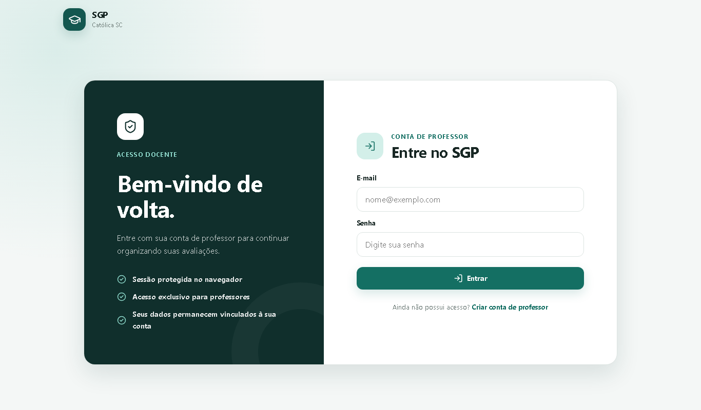

### 4.2 Página inicial

Apresenta o acesso rápido à prova mais recente do professor. Os demais fluxos ficam no menu superior: Provas, Aplicações, Turmas, Questões e Relatórios.

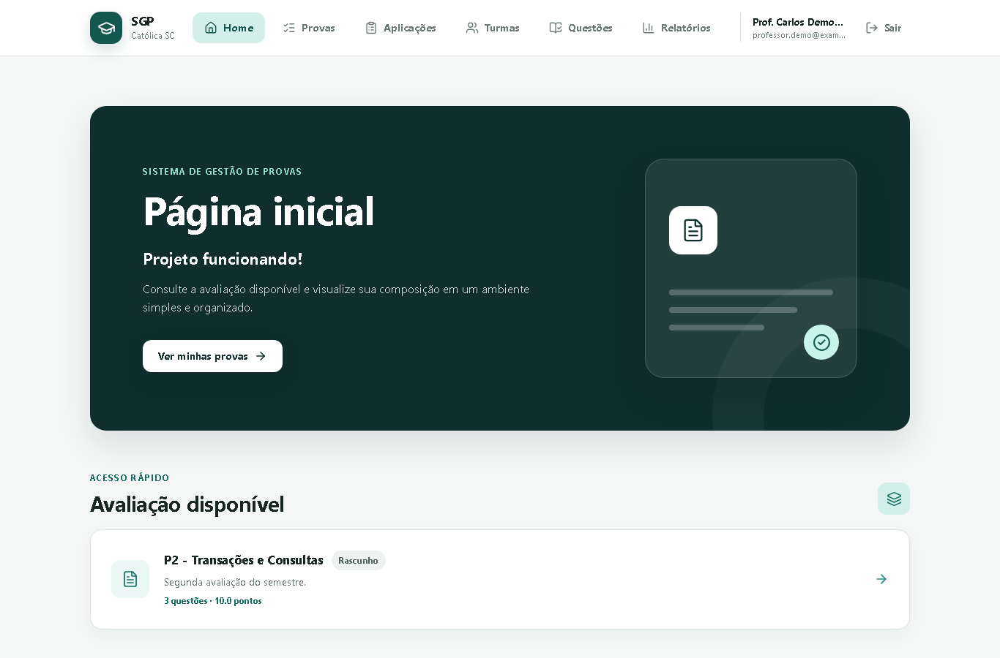

### 4.3 Turmas

Exibe os dados da turma, o código de convite e os alunos vinculados, que podem ser adicionados (inclusive cadastrando um novo registro acadêmico) ou removidos.

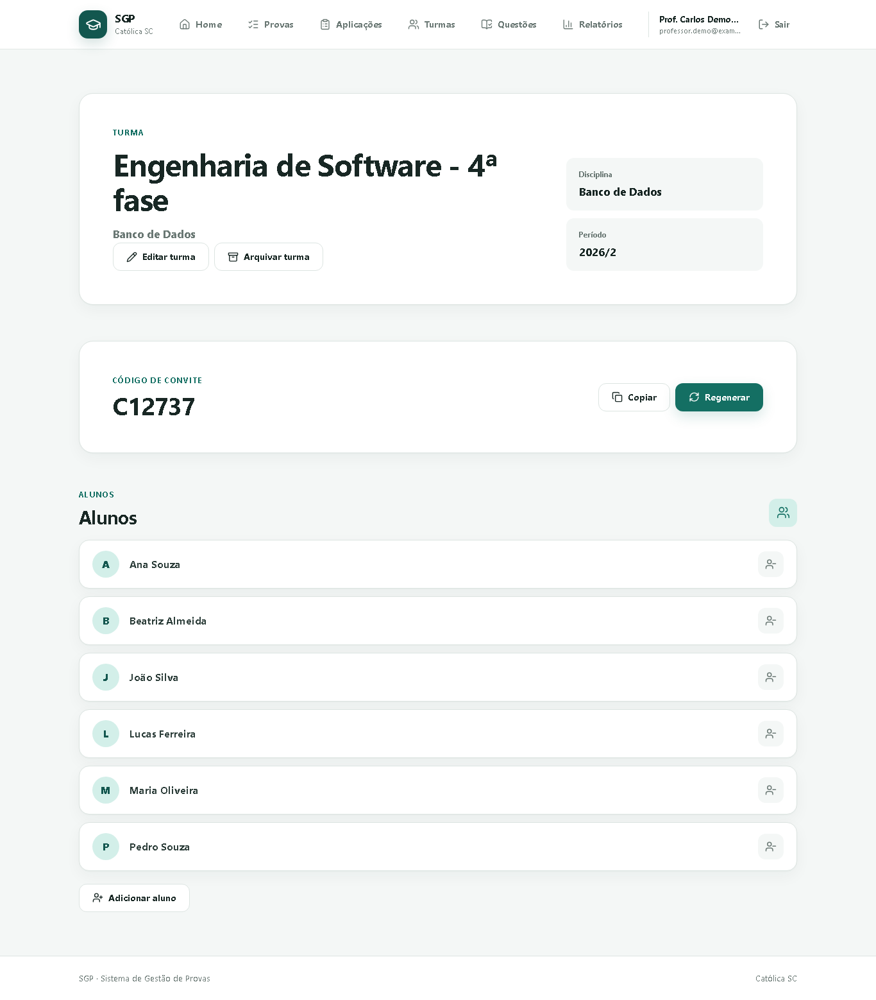

### 4.4 Banco de questões

Lista as questões objetivas e permite pesquisar por enunciado ou tag, filtrar por tag, editar, excluir e iniciar um novo cadastro.

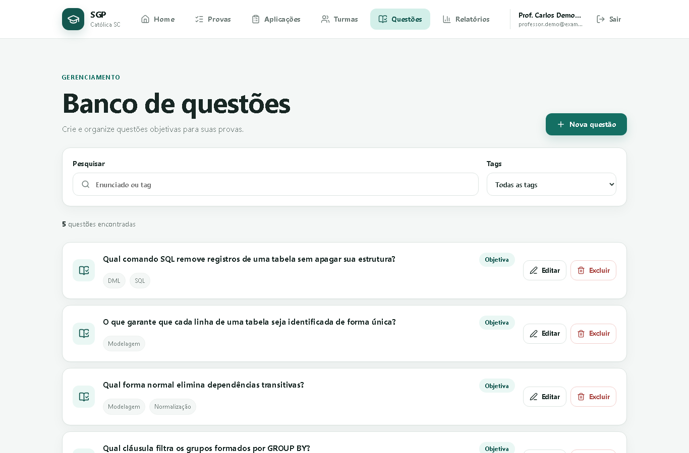

### 4.5 Formulário de questão objetiva

Permite informar o enunciado, cadastrar de duas a cinco alternativas, marcar exatamente uma resposta correta e adicionar tags.

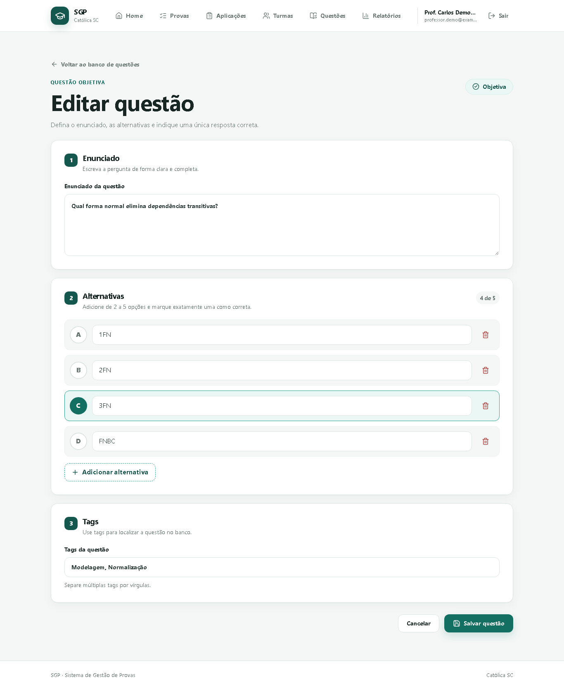

### 4.6 Provas

Lista as provas do professor com quantidade de questões e situação. Cada prova define a ordem e a pontuação individual das questões.

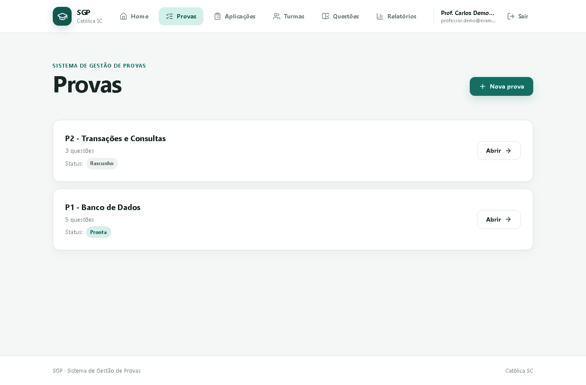

### 4.7 Aplicações

Exibe as aplicações cadastradas (prova aplicada a uma turma) e seus estados.

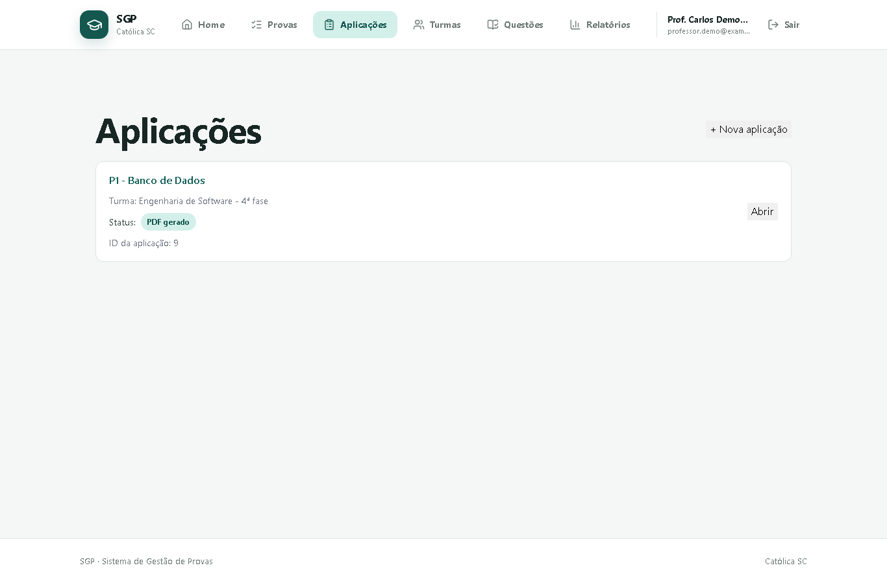

### 4.8 Versões e QR Codes

Mostra as versões geradas com embaralhamento de questões e alternativas, o gabarito de cada versão e os QR Codes de correção; com identificação, cada aluno recebe a sua versão e o seu QR Code. O botão **Cartão-resposta** monta uma página A4 com QR, quatro marcadores de alinhamento e a grade de alternativas da versão, e **Baixar PDF** gera o caderno de questões da versão seguido do cartão-resposta de cada aluno, no mesmo layout lido pela correção automática.

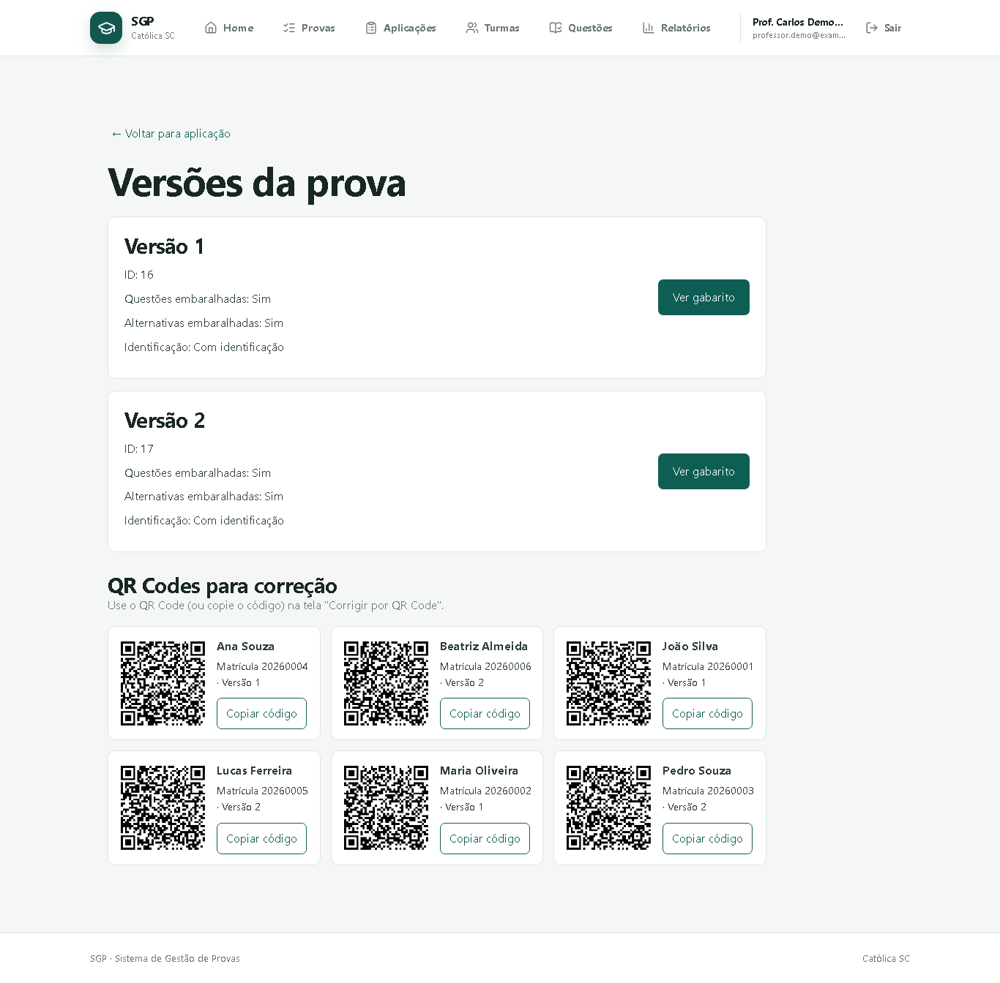

### 4.9 Correção

O professor pode abrir a câmera traseira e tocar em **Capturar cartão** ou usar **Enviar foto do cartão**. O navegador lê o QR pelos pixels da imagem (biblioteca jsQR, compatível com Android e iPhone), usa a posição do QR para deixar a foto em pé quando ela foi tirada girada, corrige a perspectiva pelos quatro marcadores e preenche as alternativas automaticamente. A imagem alinhada destaca leituras seguras em verde e rasuras/dúvidas em amarelo; qualquer resposta pode ser corrigida antes de salvar.

A foto é processada somente em memória no aparelho: não é enviada à API, gravada no banco, colocada em `localStorage` ou registrada em logs. O servidor recebe apenas QR, identificação e IDs das respostas, calcula a nota e a devolve para destaque na tela.

O caminho manual permanece disponível: se a câmera ou a leitura automática falhar, informe o código do QR e marque/revise as respostas manualmente. O acesso à câmera exige HTTPS; o endereço publicado no Render já atende esse requisito. Após salvar, a nota aparece em destaque com o botão **Corrigir outra prova**.

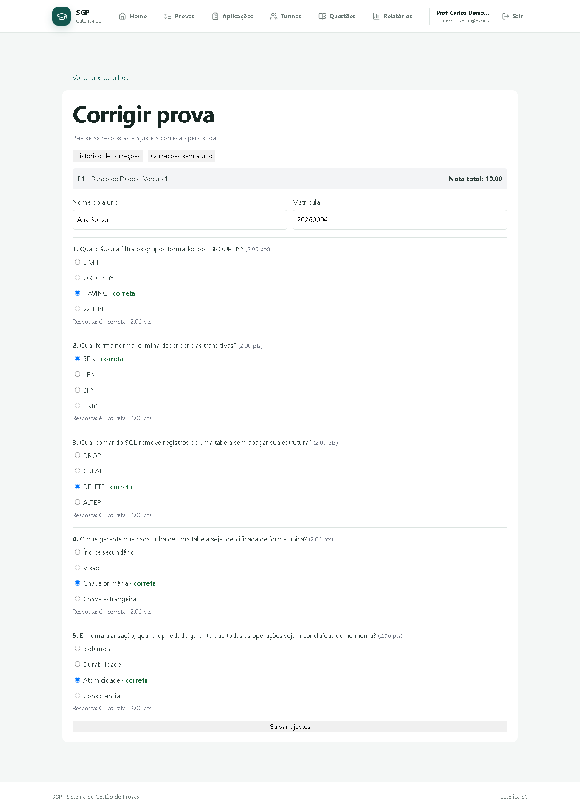

### 4.10 Relatórios

Apresenta média, mediana, maior e menor nota, distribuição e notas por estudante, com filtros por turma, aplicação e período e exportação em CSV.

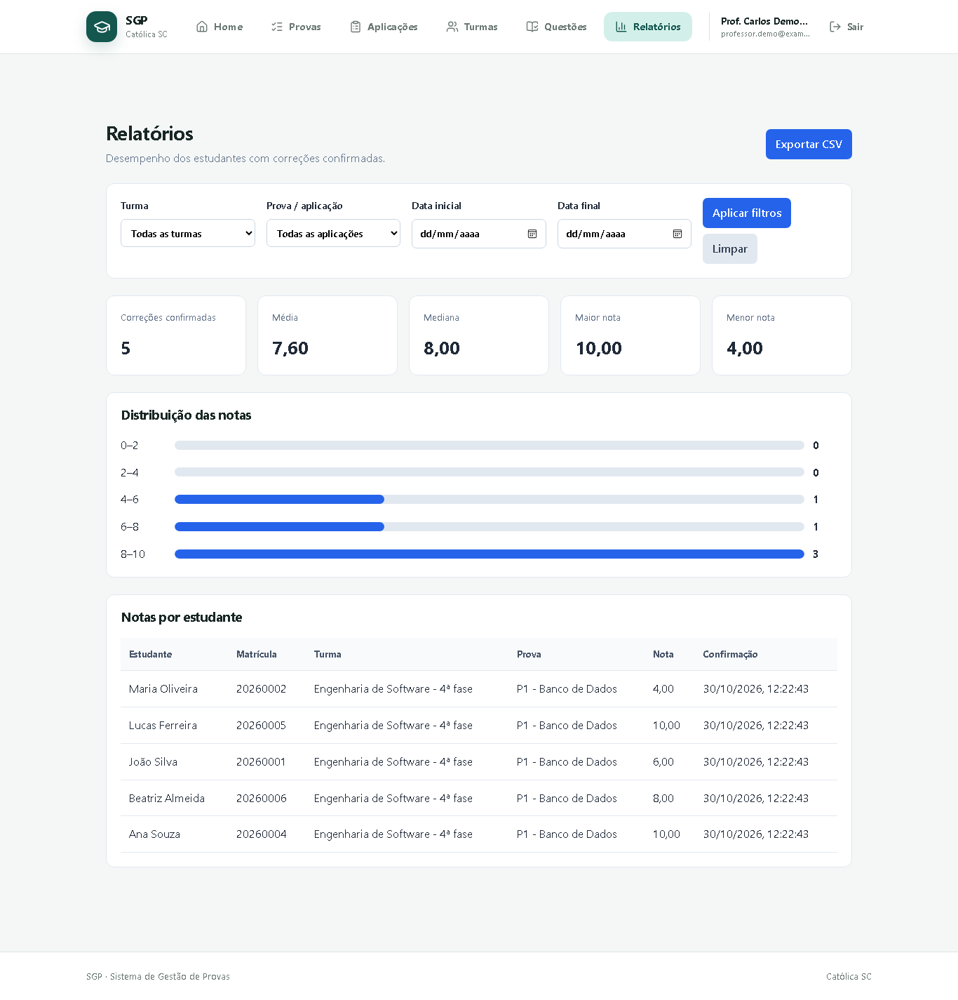

---

## 5. Arquitetura e Diagramas UML

### 5.1 Arquitetura em camadas

O front-end Vue consome a API REST do Express pelo prefixo `/api`. Cada módulo
do back-end segue o mesmo padrão de camadas, e somente os repositories acessam
o MySQL.

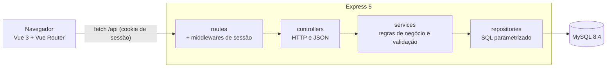

### 5.2 Casos de uso

O professor é o único ator com acesso. O aluno é apenas um registro acadêmico.

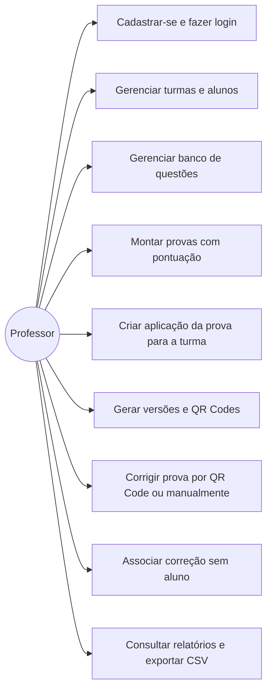

### 5.3 Diagrama de classes de domínio

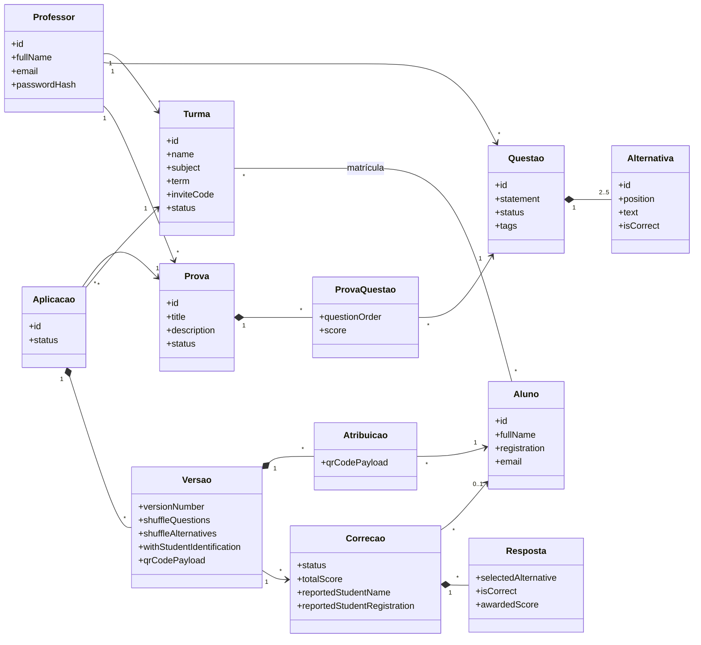

### 5.4 Diagrama de sequência: correção por QR Code

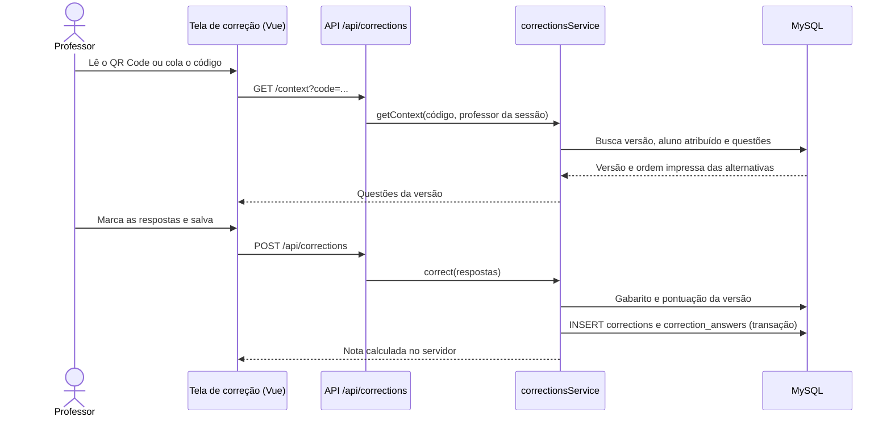

---

## 6. Decisões Arquiteturais

- [ADR-001 — Uso de MySQL como banco relacional](docs/adr/ADR-001-banco-de-dados-mysql.md)
- [ADR-002 — Acesso exclusivo de professores](docs/adr/ADR-002-acesso-exclusivo-professores.md)
- [ADR-003 — Hospedagem no Render com MySQL no Aiven](docs/adr/ADR-003-hospedagem-render-aiven.md)

---

## 7. Banco de Dados e Especificação N2

- [Especificação técnica N2 para desenvolvedores](docs/especificacao-n2-desenvolvedores.md)
- [Análise de implementação do banco de dados](docs/n2-banco-dados.md)
- [DER interativo no FigJam](https://www.figma.com/board/8tCcW4wk7t3w2adUv34xBT?utm_source=chatgpt&utm_content=edit_in_figjam&oai_id=v1%2Fq5XUnBHbCjMfA9GW3qVOlu0BpFFJZZdnYOyAG9tDdxes1P3BzDT9Yi)
- [DER do banco em Mermaid](docs/der-sgp-n2.mmd)
- [Schema e dados iniciais](database/init.sql)

### 7.1 Estado da integração com o banco

Todas as telas operam sobre o MySQL. Nenhuma tela usa dados simulados; o arquivo
`src/client/data/testFixtures.js` é usado apenas pelos testes automatizados.

| Tela | Operações no banco | API |
|---|---|---|
| Cadastro e login | Cadastrar professor, entrar, sair, restaurar sessão | `/api/auth` |
| Página inicial | Exibir a prova mais recente do professor | `/api/exams` |
| Turmas | Cadastrar, listar, editar, arquivar, regenerar código, adicionar/cadastrar e remover alunos | `/api/classes` |
| Banco de questões | Cadastrar, listar, pesquisar, filtrar por tag, editar e excluir (arquiva se já usada) | `/api/questions` |
| Provas | Cadastrar, listar, detalhar, editar e arquivar, com pontuação por questão | `/api/exams` |
| Aplicações | Criar (prova × turma), listar e detalhar | `/api/applications` |
| Versões | Gerar versões com embaralhamento, atribuir alunos, QR Codes e gabarito | `/api/application-versions` |
| Correções | Corrigir por QR Code, lançar manualmente, ajustar e associar correção sem aluno | `/api/corrections` |
| Relatórios | Média, mediana, distribuição, notas por aluno, filtros e CSV | `/api/reports` |

Regras garantidas pela API: cada consulta filtra pelo professor da sessão;
questões têm de 2 a 5 alternativas e exatamente uma correta; gravações com
várias tabelas usam transação; prova arquivada ou encerrada não recebe nova
aplicação; prova sem questões ou turma sem alunos não gera aplicação; o mesmo
aluno não recebe duas correções confirmadas na mesma versão; as versões só podem
ser regeradas, e a prova só pode ser editada, enquanto não houver correção
confirmada; e o status da aplicação e da prova é recalculado a cada correção.

---

## 8. Stack Tecnológica

| Camada | Tecnologia | Uso no projeto |
|---|---|---|
| Front-end | Vue.js 3 | Componentes e interface reativa |
| Rotas | Vue Router | Navegação da aplicação de página única |
| Build | Vite 8 | Ambiente de desenvolvimento e geração do bundle |
| Estilos | CSS | Layout responsivo, tokens visuais e componentes |
| Ícones | Lucide Vue | Iconografia da interface |
| QR Code | qrcode e jsQR | Geração dos QR Codes e leitura do QR na foto do cartão em qualquer navegador |
| PDF | pdfkit | PDF da prova com caderno de questões e cartão-resposta |
| Servidor | Node.js e Express 5 | API REST em camadas, entrega do build e fallback da SPA |
| Autenticação | bcrypt e cookie de sessão | Hash de senha e sessão do professor |
| Banco de dados | MySQL 8.4 e MySQL2 | Persistência relacional e pool de conexões |
| Testes | Vitest | Testes automatizados do front-end, da API e de integração com MySQL |
| Versionamento | Git e GitHub | Histórico e colaboração do projeto |
| Hospedagem | Render e Aiven | Aplicação Node.js publicada e MySQL gerenciado com TLS |

---

## 9. Estrutura de Pastas

```text
Correcao-Provas/
├── database/
│   ├── init.sql                # Criação do schema e carga dos dados iniciais
│   ├── migrations/             # Migrações aditivas para bancos já existentes
│   └── setup-remote.js         # Aplica o schema em um MySQL hospedado
├── docs/
│   ├── adr/                    # Decisões arquiteturais da N2
│   └── telas/                  # Capturas utilizadas nesta documentação
├── src/
│   ├── client/
│   │   ├── components/         # Layout e componentes reutilizáveis
│   │   ├── data/               # Stores (sessão, questões) e catálogo de status
│   │   ├── router/             # Rotas e guarda de autenticação
│   │   ├── services/           # Chamadas à API REST
│   │   ├── styles/             # Estilos globais e tokens
│   │   ├── utils/              # Formatação compartilhada
│   │   ├── views/              # Telas organizadas por fluxo
│   │   ├── App.vue
│   │   └── main.js
│   ├── config/                 # Pool MySQL, sessão e proxy
│   ├── controllers/            # Camada HTTP de cada módulo
│   ├── http/                   # Erros da API e cookie de sessão
│   ├── middlewares/            # Sessão do professor e limite de login
│   ├── repositories/           # Acesso ao MySQL
│   ├── routes/                 # Rotas Express por módulo
│   ├── services/               # Regras de negócio
│   ├── shared/                 # Layout do cartão-resposta usado pelo PDF, pela impressão e pelo leitor
│   ├── app.js                  # Aplicação Express
│   └── server.js               # Inicialização do servidor
├── .env.example                # Modelo das variáveis de ambiente
├── compose.yaml                # MySQL local com Docker Compose
├── index.html                  # Entrada do Vite
├── package.json                # Dependências e scripts
├── README.md
└── vite.config.mjs             # Configuração do build e dos testes
```

---

## 10. Como Executar

### Pré-requisitos

- [Git](https://git-scm.com/)
- [Node.js](https://nodejs.org/) 20.19 ou superior, ou 22.12 ou superior
- npm
- Docker Desktop, ou uma instalação local do MySQL 8.4

### Ambiente de desenvolvimento

```bash
git clone https://github.com/VitorRinkawetsky/Correcao-Provas.git
cd Correcao-Provas
npm install
```

No Windows PowerShell, copie o modelo de variáveis de ambiente:

```powershell
Copy-Item .env.example .env
```

Em Linux ou macOS:

```bash
cp .env.example .env
```

Suba o banco local e inicie a API em outro terminal:

```bash
npm run db:up
npm run dev:server
```

Depois, inicie o Vite:

```bash
npm run dev
```

A aplicação ficará disponível, por padrão, em [http://localhost:5173](http://localhost:5173).

Para iniciar o banco da N2:

```bash
npm run db:up
```

Para validar a conexão pelo Express:

```bash
npm run build
npm start
```

Abra [http://localhost:3000/api/health](http://localhost:3000/api/health).

O Vite encaminha as chamadas `/api` para o Express em [http://localhost:3000](http://localhost:3000). Todas as telas consultam e gravam os dados no MySQL pela API (veja [7.1 Estado da integração com o banco](#71-estado-da-integração-com-o-banco)).

A API usa exclusivamente a identidade do professor autenticado pelo cookie de
sessão. Crie uma conta em `#/cadastro` e entre por `#/login`; identificadores em
corpo, query string ou cabeçalho não substituem a sessão.

O professor incluído no seed (`carlos.silva@catolicasc.org.br`) existe apenas
para relacionar os dados acadêmicos de exemplo e não possui senha. Portanto, o
primeiro acesso deve ser feito pelo cadastro de uma nova conta de professor.
Alunos permanecem somente como registros das turmas e não podem autenticar.

Na tela de detalhes de uma aplicação, **Corrigir por QR Code** mantém o fluxo de
leitura automática do cartão pela câmera ou por upload (com entrada manual do
código e das respostas como alternativa), enquanto
**Histórico de correções** e **Correções sem aluno** abrem os fluxos de consulta
e associação manual. A API reserva `POST /api/corrections` para o QR Code e usa
`POST /api/corrections/manual` para o lançamento manual.

O contrato físico do cartão fica centralizado em
`src/shared/answerSheetLayout.mjs`: página normalizada de 1000 × 1414 px,
quatro marcadores, até 20 questões e de duas a cinco alternativas. O cartão
impresso pela tela de versões, o cartão do PDF gerado no servidor e o leitor
usam esse mesmo arquivo; não duplique essas medidas.

Se o volume MySQL já existia antes da autenticação, aplique uma vez a migração
aditiva, sem apagar os dados:

```bash
docker compose exec -T db mysql -usgp -psgp_dev correcao_provas < database/migrations/20261025_create_auth_sessions.sql
```

No PowerShell:

```powershell
Get-Content -Raw .\database\migrations\20261025_create_auth_sessions.sql |
    docker compose exec -T db mysql -usgp -psgp_dev correcao_provas
```

O `database/init.sql` já inclui a tabela para volumes novos.

### Testes

```bash
npm run db:up
npm test
```

Os testes de integração com MySQL (autenticação, transações de correção e o
fluxo autenticado por QR Code) rodam quando o banco local está acessível e são
ignorados quando não está, como no pipeline do GitHub Actions. Para rodar só
essas suítes:

```bash
npm run test:mysql
```

Os testes do leitor não dependem de banco e podem ser executados isoladamente:

```bash
npx vitest run src/client/services/answerSheetReader.test.js src/client/services/answerSheetCapture.test.js src/client/components/AnswerSheetPrint.test.js src/client/views/CorrecaoView.test.js src/client/views/AplicacaoVersoesView.test.js src/services/applicationVersionsService.test.js
```

Esses testes usam cartões sintéticos determinísticos de 5 e 20 questões. A
leitura também foi validada no site publicado com foto, tirada pelo celular, de
um cartão impresso e preenchido a caneta. Para melhores resultados, use boa luz,
evite sombras e mantenha os quatro quadrados do cartão visíveis na foto.

### Build e execução de produção

```bash
npm run build
npm start
```

Em produção, configure `NODE_ENV=production`; fora dos modos explícitos
`development` e `test`, o cookie de sessão é emitido com `Secure`. Se houver
proxy reverso terminando HTTPS, configure `TRUST_PROXY_HOPS` com a quantidade
exata de proxies confiáveis entre o cliente e o Express (por exemplo, `1` para
um único proxy). Não use um valor amplo: o IP resolvido também protege o login
contra excesso de tentativas. O servidor Express usa a porta definida em
`PORT` ou, na ausência dela, a porta `3000`.

### Publicação (hospedagem)

O sistema está publicado em
[https://sgp-catolica.onrender.com](https://sgp-catolica.onrender.com): a
aplicação roda no **Render** (plano gratuito) e o banco no **Aiven for MySQL**
(plano gratuito, conexão TLS). A decisão está registrada na
[ADR-003](docs/adr/ADR-003-hospedagem-render-aiven.md).

- Cada push na branch `main` gera um novo deploy automático no Render.
- No plano gratuito, o serviço hiberna após cerca de 15 minutos sem acesso; o
  primeiro acesso seguinte leva aproximadamente um minuto.
- Para conferir a conexão com o banco, acesse
  [/api/health](https://sgp-catolica.onrender.com/api/health).
- Para usar, crie uma conta de professor em **Criar conta de professor** e
  entre com ela.

O Express entrega o front-end compilado (`dist/`) e a API no mesmo endereço,
então basta um serviço Node.js e um banco MySQL hospedado. Para reproduzir a
publicação em outro ambiente:

1. Crie o banco MySQL no provedor e anote host, porta, usuário, senha e nome.
2. Aplique o schema **uma única vez** (o comando recria as tabelas e apaga os
   dados do banco informado):

   ```bash
   CONFIRM_RESET=sim npm run db:setup
   ```

   No PowerShell: `$env:CONFIRM_RESET='sim'; npm run db:setup`. O comando usa as
   variáveis `DB_*` do `.env` ou do ambiente.
3. No serviço Node.js, configure:
   - Build: `npm ci --include=dev && npm run build`
   - Start: `npm start`
   - Variáveis: `NODE_ENV=production`, `NODE_VERSION=22`, `TRUST_PROXY_HOPS=1`, `DB_HOST`,
     `DB_PORT`, `DB_USER`, `DB_PASSWORD`, `DB_NAME`, `DB_SSL=true` e, se o
     provedor exigir, `DB_SSL_CA`.
4. Acesse a URL publicada, crie a conta de professor em `#/cadastro` e confira
   `/api/health`.

---

## 14. Equipe e Contribuições

| Integrante | Principais contribuições na N1 |
|---|---|
| Vitor Rinkawetsky | Estrutura inicial, dados simulados, migração para Vue, integração e correções gerais |
| Weliton Rodrigues | Listagem, formulário e detalhes de provas |
| Laura Donath | Listagem, criação, detalhes, geração e versões de aplicações |
| Ana Clara Tomaselli Borchardt | Banco, pesquisa e formulário de questões objetivas |
| Gustavo Gorges Koch | Listagem, formulário e detalhes de turmas |

---

<div align="center">

Projeto acadêmico desenvolvido para o curso de Engenharia de Software da Católica SC.

</div>
