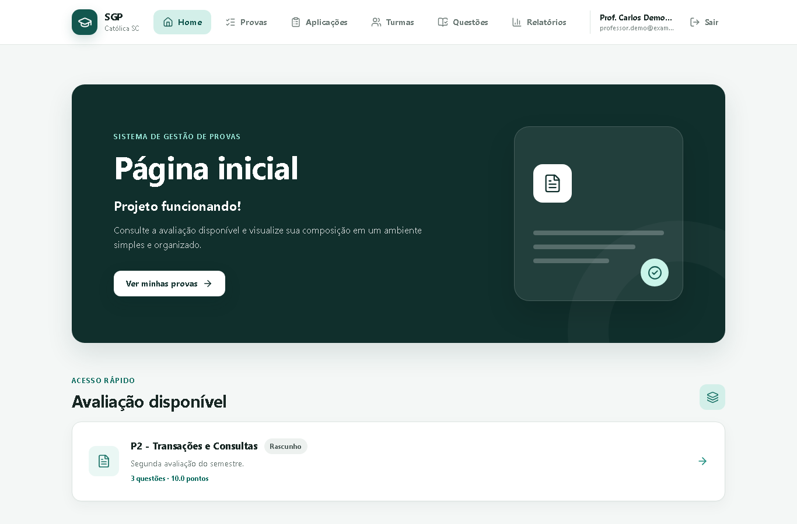
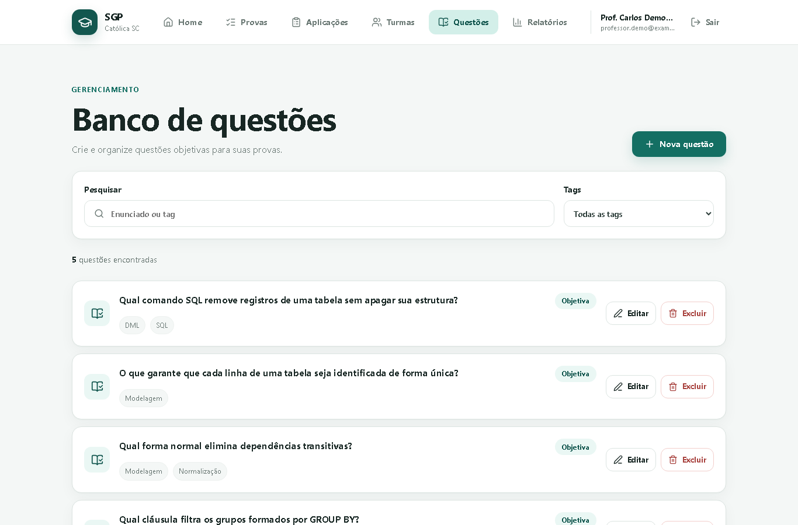
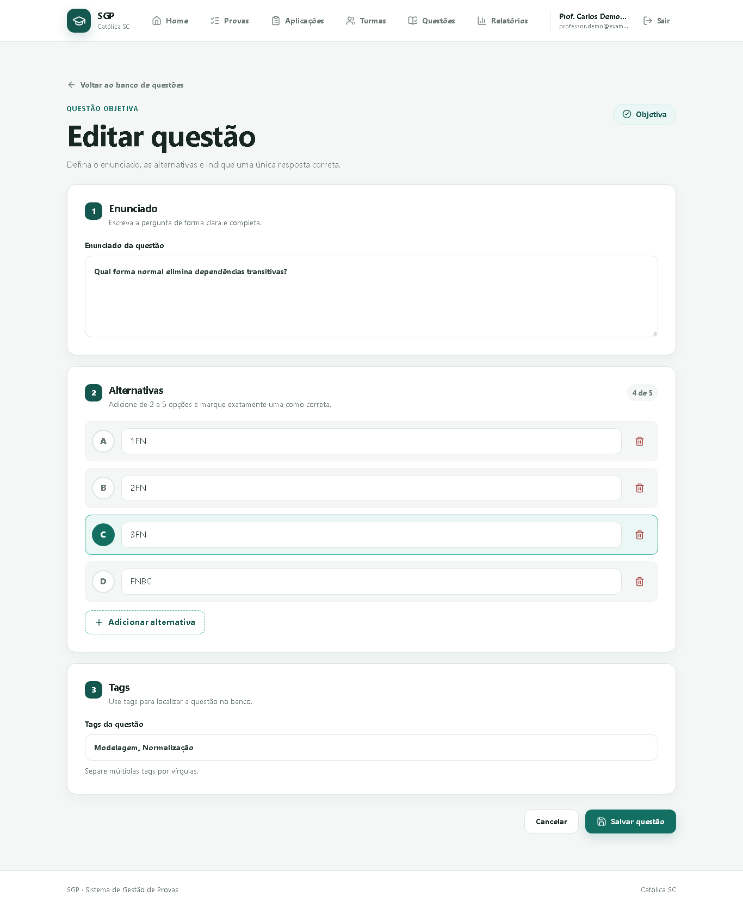
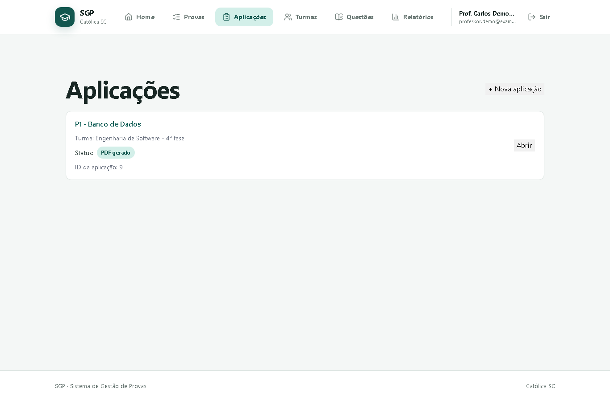
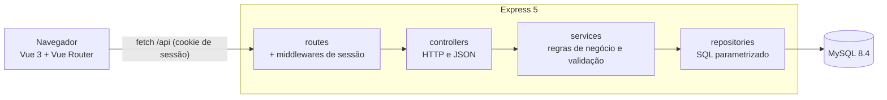
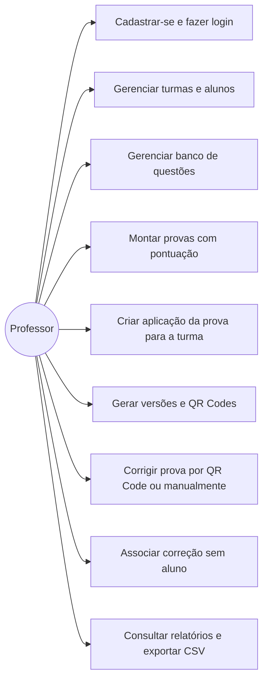
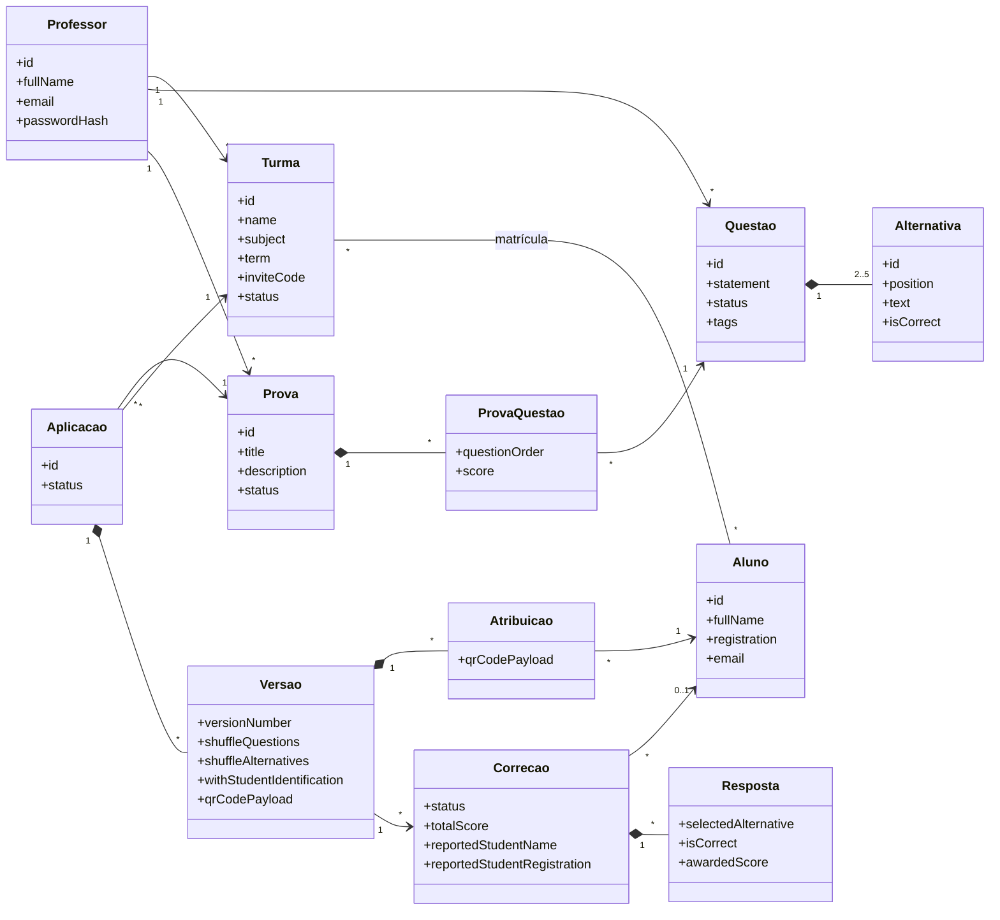
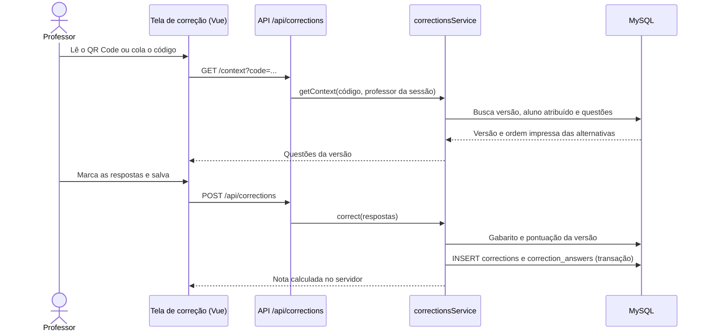

<div align="center">

# SGP Católica

### Sistema de Gestão de Provas

Plataforma acadêmica para criação, aplicação e correção de provas, operada exclusivamente por professores da Católica SC.

🔗 **Sistema hospedado:** _adicione aqui o link após a publicação_<br>
💻 **Código-fonte:** [github.com/VitorRinkawetsky/Correcao-Provas](https://github.com/VitorRinkawetsky/Correcao-Provas)


</div>

---

## 👥 Equipe

| Integrante | Atuação nesta entrega |
|---|---|
| Vitor Rinkawetsky | Configuração do projeto, integração das telas e revisão do front-end |
| Weliton Rodrigues | Fluxos de provas e tela de detalhes da avaliação |
| Laura Donath | Fluxos de aplicações, versões e atalhos da página inicial |
| Ana Clara Tomaselli Borchardt | Banco e formulário de questões objetivas |
| Gustavo Gorges Koch | Fluxos de turmas e estudantes |

---

## 📑 Sumário

- [1. Visão Geral](#1-visão-geral)
- [2. Requisitos](#2-requisitos)
  - [2.1 Requisitos Funcionais](#21-requisitos-funcionais)
  - [2.2 Requisitos Não Funcionais](#22-requisitos-não-funcionais)
- [4. Telas do Sistema](#4-telas-do-sistema)
- [5. Arquitetura e Diagramas UML](#5-arquitetura-e-diagramas-uml)
- [6. Decisões Arquiteturais](#6-decisões-arquiteturais)
- [7. Banco de Dados e Especificação N2](#7-banco-de-dados-e-especificação-n2)
- [8. Stack Tecnológica](#8-stack-tecnológica)
- [9. Estrutura de Pastas](#9-estrutura-de-pastas)
- [10. Como Executar](#10-como-executar)
- [14. Equipe e Contribuições](#14-equipe-e-contribuições)

---

## 1. Visão Geral

O **SGP Católica** é um projeto acadêmico criado para apoiar o ciclo de avaliações da instituição. A proposta é reduzir o trabalho manual dos professores por meio de um ambiente único para organizar questões, montar provas, gerar aplicações e acompanhar correções.

Na **N1**, o repositório passou a apresentar um protótipo navegável em Vue.js, abastecido por dados simulados. Na **N2**, todas as telas passaram a ler e gravar em um banco **MySQL** real por meio de uma API REST em camadas (rotas, controllers, services e repositories). Não há mais dados simulados nas telas: o professor se cadastra, faz login e cada um vê somente os próprios dados.

### Objetivos

- Centralizar a organização de avaliações e questões.
- Permitir questões objetivas com duas a cinco alternativas e uma única resposta correta.
- Facilitar a localização de questões por texto e tags.
- Representar o fluxo de criação, geração e acompanhamento de aplicações.
- Oferecer uma interface simples, consistente e adaptável a diferentes tamanhos de tela.

### Público-alvo

- Professores responsáveis pela criação e aplicação de avaliações.

Os alunos são mantidos apenas como registros acadêmicos vinculados às turmas,
provas e correções. Eles não possuem conta nem acesso ao sistema.

---

## 2. Requisitos

Os requisitos abaixo representam a visão do produto. A coluna **Situação atual** indica o estado na entrega da N2.

### 2.1 Requisitos Funcionais

| Código | Requisito | Situação atual |
|---|---|---|
| RF01 | Permitir criar, editar, listar e excluir questões objetivas. | Integrado ao MySQL |
| RF02 | Permitir de duas a cinco alternativas por questão e exigir uma única alternativa correta. | Integrado ao MySQL |
| RF03 | Permitir associar tags às questões e pesquisar o banco por enunciado ou tag. | Integrado ao MySQL |
| RF04 | Criar, editar, arquivar e consultar provas com pontuação por questão. | Integrado ao MySQL |
| RF05 | Permitir criar, listar e consultar aplicações associadas a uma prova e a uma turma. | Integrado ao MySQL |
| RF06 | Configurar versões da aplicação, embaralhamento de questões e alternativas e identificação do estudante, com QR Code por aluno ou por versão. | Integrado ao MySQL |
| RF07 | Permitir cadastrar turmas e estudantes. | Integrado ao MySQL |
| RF08 | Corrigir provas pelo QR Code (câmera ou código) e lançar respostas manualmente. | Integrado ao MySQL |
| RF09 | Calcular notas e disponibilizar relatórios e estatísticas da avaliação, com exportação CSV. | Integrado ao MySQL |
| RF10 | Autenticar professores e restringir os dados ao professor responsável. | Integrado ao MySQL |
| RF11 | Ler o cartão-resposta preenchido por imagem (visão computacional). | Planejado para a N3 |

### 2.2 Requisitos Não Funcionais

| Código | Requisito |
|---|---|
| RNF01 | A interface deve ser responsiva e utilizável em navegadores modernos. |
| RNF02 | A navegação deve usar elementos semânticos, foco visível e suporte a teclado. |
| RNF03 | A experiência deve ser simples, consistente e apresentada em português do Brasil. |
| RNF04 | O front-end deve funcionar como uma aplicação de página única com Vue Router. |
| RNF05 | Configurações de ambiente e credenciais não devem ser versionadas no código-fonte. |
| RNF06 | A persistência deve utilizar banco relacional MySQL. |
| RNF07 | Senhas e demais dados sensíveis não devem ser armazenados em texto puro. |
| RNF08 | O projeto deve possuir comandos reproduzíveis para desenvolvimento, testes e build. |

---

## 4. Telas do Sistema

### 4.1 Página inicial

Apresenta o acesso rápido à prova mais recente do professor. Os demais fluxos ficam no menu superior: Provas, Aplicações, Turmas, Banco de questões e Relatórios.



### 4.2 Banco de questões

Lista as questões objetivas e permite pesquisar por enunciado ou tag, filtrar por tag, editar, excluir e iniciar um novo cadastro.



### 4.3 Formulário de questão objetiva

Permite informar o enunciado, cadastrar de duas a cinco alternativas, marcar exatamente uma resposta correta e adicionar tags.



### 4.4 Aplicações

Exibe as aplicações cadastradas, suas turmas, estados e o progresso de correção.



---

## 5. Arquitetura e Diagramas UML

### 5.1 Arquitetura em camadas

O front-end Vue consome a API REST do Express pelo prefixo `/api`. Cada módulo
do back-end segue o mesmo padrão de camadas, e somente os repositories acessam
o MySQL.



### 5.2 Casos de uso

O professor é o único ator com acesso. O aluno é apenas um registro acadêmico.



### 5.3 Diagrama de classes de domínio



### 5.4 Diagrama de sequência: correção por QR Code



---

## 6. Decisões Arquiteturais

- [ADR-001 — Uso de MySQL como banco relacional](docs/adr/ADR-001-banco-de-dados-mysql.md)
- [ADR-002 — Acesso exclusivo de professores](docs/adr/ADR-002-acesso-exclusivo-professores.md)

---

## 7. Banco de Dados e Especificação N2

- [Especificação técnica N2 para desenvolvedores](docs/especificacao-n2-desenvolvedores.md)
- [Análise de implementação do banco de dados](docs/n2-banco-dados.md)
- [DER interativo no FigJam](https://www.figma.com/board/8tCcW4wk7t3w2adUv34xBT?utm_source=chatgpt&utm_content=edit_in_figjam&oai_id=v1%2Fq5XUnBHbCjMfA9GW3qVOlu0BpFFJZZdnYOyAG9tDdxes1P3BzDT9Yi)
- [DER do banco em Mermaid](docs/der-sgp-n2.mmd)
- [Schema e dados iniciais](database/init.sql)

### 7.1 Estado da integração com o banco

Todas as telas operam sobre o MySQL. Nenhuma tela usa dados simulados; o arquivo
`src/client/data/testFixtures.js` é usado apenas pelos testes automatizados.

| Tela | Operações no banco | API |
|---|---|---|
| Cadastro e login | Cadastrar professor, entrar, sair, restaurar sessão | `/api/auth` |
| Página inicial | Exibir a prova mais recente do professor | `/api/exams` |
| Turmas | Cadastrar, listar, editar, arquivar, regenerar código, adicionar/cadastrar e remover alunos | `/api/classes` |
| Banco de questões | Cadastrar, listar, pesquisar, filtrar por tag, editar e excluir (arquiva se já usada) | `/api/questions` |
| Provas | Cadastrar, listar, detalhar, editar e arquivar, com pontuação por questão | `/api/exams` |
| Aplicações | Criar (prova × turma), listar e detalhar | `/api/applications` |
| Versões | Gerar versões com embaralhamento, atribuir alunos, QR Codes e gabarito | `/api/application-versions` |
| Correções | Corrigir por QR Code, lançar manualmente, ajustar e associar correção sem aluno | `/api/corrections` |
| Relatórios | Média, mediana, distribuição, notas por aluno, filtros e CSV | `/api/reports` |

Regras garantidas pela API: cada consulta filtra pelo professor da sessão;
questões têm de 2 a 5 alternativas e exatamente uma correta; gravações com
várias tabelas usam transação; prova arquivada não recebe nova aplicação; e as
versões de uma aplicação só podem ser regeradas enquanto não houver correção
confirmada.

---

## 8. Stack Tecnológica

| Camada | Tecnologia | Uso no projeto |
|---|---|---|
| Front-end | Vue.js 3 | Componentes e interface reativa |
| Rotas | Vue Router | Navegação da aplicação de página única |
| Build | Vite 8 | Ambiente de desenvolvimento e geração do bundle |
| Estilos | CSS | Layout responsivo, tokens visuais e componentes |
| Ícones | Lucide Vue | Iconografia da interface |
| QR Code | qrcode | Imagens dos QR Codes de correção |
| Servidor | Node.js e Express 5 | API REST em camadas, entrega do build e fallback da SPA |
| Autenticação | bcrypt e cookie de sessão | Hash de senha e sessão do professor |
| Banco de dados | MySQL 8.4 e MySQL2 | Persistência relacional e pool de conexões |
| Testes | Vitest | Testes automatizados do front-end, da API e de integração com MySQL |
| Versionamento | Git e GitHub | Histórico e colaboração do projeto |

---

## 9. Estrutura de Pastas

```text
Correcao-Provas/
├── database/
│   ├── init.sql                # Criação do schema e carga dos dados iniciais
│   ├── migrations/             # Migrações aditivas para bancos já existentes
│   └── setup-remote.js         # Aplica o schema em um MySQL hospedado
├── docs/
│   ├── adr/                    # Decisões arquiteturais da N2
│   └── telas/                  # Capturas utilizadas nesta documentação
├── src/
│   ├── client/
│   │   ├── components/         # Layout e componentes reutilizáveis
│   │   ├── data/               # Stores (sessão, questões) e catálogo de status
│   │   ├── router/             # Rotas e guarda de autenticação
│   │   ├── services/           # Chamadas à API REST
│   │   ├── styles/             # Estilos globais e tokens
│   │   ├── utils/              # Formatação compartilhada
│   │   ├── views/              # Telas organizadas por fluxo
│   │   ├── App.vue
│   │   └── main.js
│   ├── config/                 # Pool MySQL, sessão e proxy
│   ├── controllers/            # Camada HTTP de cada módulo
│   ├── http/                   # Erros da API e cookie de sessão
│   ├── middlewares/            # Sessão do professor e limite de login
│   ├── repositories/           # Acesso ao MySQL
│   ├── routes/                 # Rotas Express por módulo
│   ├── services/               # Regras de negócio
│   ├── app.js                  # Aplicação Express
│   └── server.js               # Inicialização do servidor
├── .env.example                # Modelo das variáveis de ambiente
├── compose.yaml                # MySQL local com Docker Compose
├── index.html                  # Entrada do Vite
├── package.json                # Dependências e scripts
├── README.md
└── vite.config.mjs             # Configuração do build e dos testes
```

---

## 10. Como Executar

### Pré-requisitos

- [Git](https://git-scm.com/)
- [Node.js](https://nodejs.org/) 20.19 ou superior, ou 22.12 ou superior
- npm
- Docker Desktop, ou uma instalação local do MySQL 8.4

### Ambiente de desenvolvimento

```bash
git clone https://github.com/VitorRinkawetsky/Correcao-Provas.git
cd Correcao-Provas
npm install
```

No Windows PowerShell, copie o modelo de variáveis de ambiente:

```powershell
Copy-Item .env.example .env
```

Em Linux ou macOS:

```bash
cp .env.example .env
```

Suba o banco local e inicie a API em outro terminal:

```bash
npm run db:up
npm run dev:server
```

Depois, inicie o Vite:

```bash
npm run dev
```

A aplicação ficará disponível, por padrão, em [http://localhost:5173](http://localhost:5173).

Para iniciar o banco da N2:

```bash
npm run db:up
```

Para validar a conexão pelo Express:

```bash
npm run build
npm start
```

Abra [http://localhost:3000/api/health](http://localhost:3000/api/health).

O Vite encaminha as chamadas `/api` para o Express em [http://localhost:3000](http://localhost:3000). Todas as telas consultam e gravam os dados no MySQL pela API (veja [7.1 Estado da integração com o banco](#71-estado-da-integração-com-o-banco)).

A API usa exclusivamente a identidade do professor autenticado pelo cookie de
sessão. Crie uma conta em `#/cadastro` e entre por `#/login`; identificadores em
corpo, query string ou cabeçalho não substituem a sessão.

O professor incluído no seed (`carlos.silva@catolicasc.org.br`) existe apenas
para relacionar os dados acadêmicos de exemplo e não possui senha. Portanto, o
primeiro acesso deve ser feito pelo cadastro de uma nova conta de professor.
Alunos permanecem somente como registros das turmas e não podem autenticar.

Na tela de detalhes de uma aplicação, **Corrigir por QR Code** mantém o fluxo de
leitura pela câmera (com entrada manual do código como alternativa), enquanto
**Histórico de correções** e **Correções sem aluno** abrem os fluxos de consulta
e associação manual. A API reserva `POST /api/corrections` para o QR Code e usa
`POST /api/corrections/manual` para o lançamento manual.

Se o volume MySQL já existia antes da autenticação, aplique uma vez a migração
aditiva, sem apagar os dados:

```bash
docker compose exec -T db mysql -usgp -psgp_dev correcao_provas < database/migrations/20261025_create_auth_sessions.sql
```

No PowerShell:

```powershell
Get-Content -Raw .\database\migrations\20261025_create_auth_sessions.sql |
    docker compose exec -T db mysql -usgp -psgp_dev correcao_provas
```

O `database/init.sql` já inclui a tabela para volumes novos.

### Testes

```bash
npm run db:up
npm test
```

Os testes de integração com MySQL (autenticação, transações de correção e o
fluxo autenticado por QR Code) rodam quando o banco local está acessível e são
ignorados quando não está, como no pipeline do GitHub Actions. Para rodar só
essas suítes:

```bash
npm run test:mysql
```

### Build e execução de produção

```bash
npm run build
npm start
```

Em produção, configure `NODE_ENV=production`; fora dos modos explícitos
`development` e `test`, o cookie de sessão é emitido com `Secure`. Se houver
proxy reverso terminando HTTPS, configure `TRUST_PROXY_HOPS` com a quantidade
exata de proxies confiáveis entre o cliente e o Express (por exemplo, `1` para
um único proxy). Não use um valor amplo: o IP resolvido também protege o login
contra excesso de tentativas. O servidor Express usa a porta definida em
`PORT` ou, na ausência dela, a porta `3000`.

### Publicação (hospedagem)

O Express entrega o front-end compilado (`dist/`) e a API no mesmo endereço,
então basta um serviço Node.js e um banco MySQL hospedado.

1. Crie o banco MySQL no provedor e anote host, porta, usuário, senha e nome.
2. Aplique o schema **uma única vez** (o comando recria as tabelas e apaga os
   dados do banco informado):

   ```bash
   CONFIRM_RESET=sim npm run db:setup
   ```

   No PowerShell: `$env:CONFIRM_RESET='sim'; npm run db:setup`. O comando usa as
   variáveis `DB_*` do `.env` ou do ambiente.
3. No serviço Node.js, configure:
   - Build: `npm ci --include=dev && npm run build`
   - Start: `npm start`
   - Variáveis: `NODE_ENV=production`, `TRUST_PROXY_HOPS=1`, `DB_HOST`,
     `DB_PORT`, `DB_USER`, `DB_PASSWORD`, `DB_NAME`, `DB_SSL=true` e, se o
     provedor exigir, `DB_SSL_CA`.
4. Acesse a URL publicada, crie a conta de professor em `#/cadastro` e confira
   `/api/health`.

---

## 14. Equipe e Contribuições

| Integrante | Principais contribuições na N1 |
|---|---|
| Vitor Rinkawetsky | Estrutura inicial, dados simulados, migração para Vue, integração e correções gerais |
| Weliton Rodrigues | Listagem, formulário e detalhes de provas |
| Laura Donath | Listagem, criação, detalhes, geração e versões de aplicações |
| Ana Clara Tomaselli Borchardt | Banco, pesquisa e formulário de questões objetivas |
| Gustavo Gorges Koch | Listagem, formulário e detalhes de turmas |

---

<div align="center">

Projeto acadêmico desenvolvido para o curso de Engenharia de Software da Católica SC.

</div>
